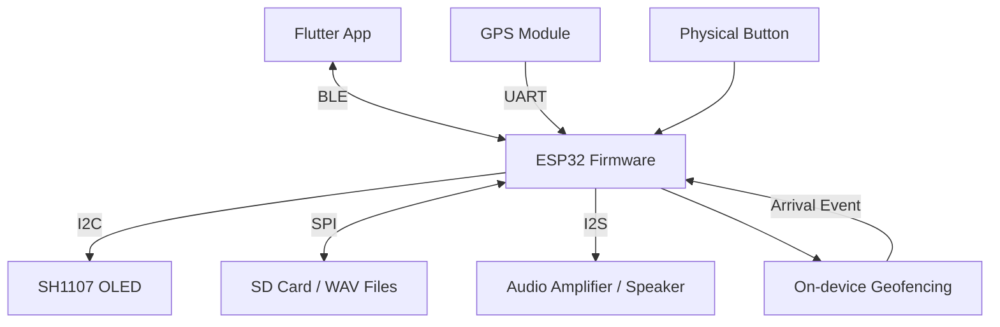

# ESP32 Firmware

## System Architecture

The firmware handles BLE communication, OLED animations,
GPS tracking, button input, and WAV playback.

The ESP32 can also detect arrival at configured locations
and play location-specific audio without the mobile app.

## Files
- `thaigotchi_firmware.ino` — Main Arduino sketch
- `animations.h` — OLED animation frames (replace placeholders with image2cpp output)
- `generate_audio.py` — Python script to generate WAV files for SD card

## Required Arduino Libraries
- Adafruit GFX Library
- Adafruit SH110X (OLED 128×128)
- TinyGPSPlus
- ArduinoJson
- ESP32 BLE Arduino (built-in)

## Board Settings
- Board: ESP32 Dev Module
- Partition Scheme: Huge APP (3MB No OTA/1MB SPIFFS)
- Upload Speed: 921600

## Workflow
1. Generate OLED animations:
   - Export PNG frames from Procreate (128×128)
   - Convert via https://javl.github.io/image2cpp/
   - Paste arrays into `animations.h`
2. Generate audio files:
   - `pip install gtts`
   - `python3 generate_audio.py`
   - Copy output WAVs to SD card
3. Upload `thaigotchi_firmware.ino` via Arduino IDE
