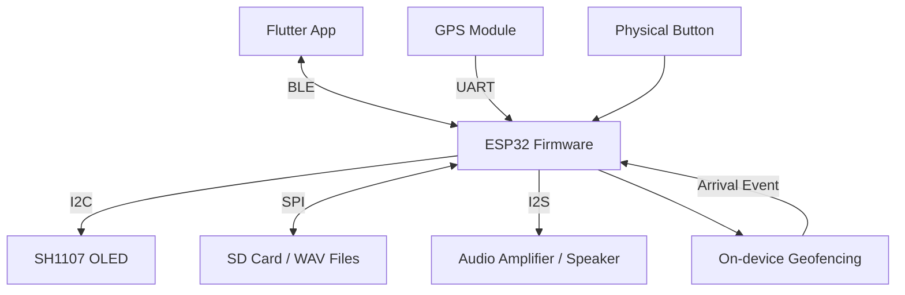

# ESP32 Firmware

## System Architecture

The firmware handles BLE communication, OLED animations,
GPS tracking, button input, and WAV playback.

The ESP32 can also detect arrival at configured locations
and play location-specific audio without the mobile app.

## Files
- `thaigotchi_firmware.ino` — Main Arduino sketch
- `animations.h` — OLED animation frames (replace placeholders with image2cpp output)
- `generate_audio.py` — Python script to generate WAV files for SD card

## Hardware Connections

| Component | ESP32 GPIO | Interface |
|---|---|---|
| OLED SDA | GPIO 21 | I2C |
| OLED SCL | GPIO 22 | I2C |
| GPS RX | GPIO 16 | UART |
| GPS TX | GPIO 17 | UART |
| Amplifier LRC | GPIO 14 | I2S |
| Amplifier BCLK | GPIO 32 | I2S |
| Amplifier DIN | GPIO 13 | I2S |
| SD Card CS | GPIO 5 | SPI |
| SD Card SCK | GPIO 18 | SPI |
| SD Card MISO | GPIO 19 | SPI |
| SD Card MOSI | GPIO 23 | SPI |
| Physical Button | GPIO 4 | Digital Input |

## Device Features

- Bluetooth Low Energy communication with the Flutter app
- GPS location notifications over BLE
- On-device geofence detection for three cultural locations
- Location-triggered WAV audio playback from SD card
- OLED animations and power-saving behavior
- Physical button handling for device interactions

## Verification

Firmware compilation can be automated through Arduino CLI.

Successful compilation verifies source compatibility with
the selected board and libraries. BLE, GPS, audio, and display
behavior still require testing on real hardware.

## Required Arduino Libraries
- Adafruit GFX Library
- Adafruit SH110X (OLED 128×128)
- TinyGPSPlus
- ArduinoJson
- ESP32 BLE Arduino (built-in)

## Board Settings
- Board: ESP32 Dev Module
- Partition Scheme: Huge APP (3MB No OTA/1MB SPIFFS)
- Upload Speed: 921600

## Workflow
1. Generate OLED animations:
   - Export PNG frames from Procreate (128×128)
   - Convert via https://javl.github.io/image2cpp/
   - Paste arrays into `animations.h`
2. Generate audio files:
   - `pip install gtts`
   - `python3 generate_audio.py`
   - Copy output WAVs to SD card
3. Upload `thaigotchi_firmware.ino` via Arduino IDE
